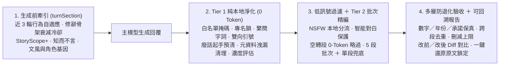

# 澄文-AutoProof-自適應敘事精修與去AI味引擎

> **LucidProse · AutoProof (`v1.39.0`)** —— 專為 [DSH Tavern](https://github.com/flizzywine/dsh-tavern) 打造的中文互動小說／長篇角色扮演 **生成前行為導航、純本地 0-Token 淨化、批次精編與可回溯校審引擎**。

[](#v1390-%E6%A0%B8%E5%BF%83%E6%9E%B6%E6%A7%8B%E8%88%87%E8%83%BD%E5%8A%9B%E7%9F%A9%E9%99%A3)
[](#%E5%AE%89%E8%A3%9D%E8%88%87%E5%B9%B3%E6%BB%91%E5%8D%87%E7%B4%9A)
[-6ee7b7)](#%E6%B8%AC%E8%A9%A6%E8%88%87%E8%A8%BA%E6%96%B7)

---

## 定位與設計哲學

長篇互動小說與酒館角色扮演在實戰中最常遇到的，往往不是單純錯別字，而是模型在多輪生成後逐漸滑向**機械對舉（「不是A，而是B」）、動作分鏡膨脹、三明治對白模板、過度生理反應渲染、開場千篇一律，以及高成本的逐段重複潤飾**。

**澄文 · AutoProof** 秉持 **「最小干預、留住角色靈魂、純本地優先、改後可審可退」** 四項核心原則，在不更動既有事件、因果與角色關係的前提下，透過四階段自適應流水線把文本拉回真實、乾淨、有呼吸感的真人敘事。

> **平滑升級保證**：為確保所有老用戶零痛升級，底層套件識別 ID（`dsh-tavern-autoproof`）與事件通道維持不變；從舊版升級至 **v1.39.0** 後，既有**正面文風卡、寫作範例、多角色語言基因卡、專名鎖、白名單與歷史校對資料**均完整繼承，無需任何重新設定。

---

## 四階段自適應精修流水線



---

## v1.39.0 核心架構與能力矩陣

### 一、v1.39 輕量模型精準化 ＋ 高效率批次精編與可回溯審稿

- **L1 量化風格指紋 (`computeL1StyleFingerprint`) ＋ 規則衝突仲裁優先級（Flash 級模型專項強化）**
  - 本地 0-Token 計算「短句（<=15字）與長句（>=50字）佔比、段落平均句數、破折號／省略號／括號千字密度」，在萃取正面文風卡時自動寫入簡短【量化節奏基準】，幫助 Flash 級輕量模型準確抓到目標文體的實際句法呼吸。
  - `buildRewriteSystem` 與 `turnSection` 新增明確的四階 **規則衝突仲裁優先級**：`劇情事實 ＞ 本卡文風基準／角色基因 ＞ 已確診 P0 病灶 ＞ 一般習慣提醒`；同時由 `deriveStyleDnaOverrides` 依文風基準自動放寬 `dashLimit` 或豁免 `telegraph_short_paras`，避免主模型學了原作風格後又在本地／Tier 2 被誤判抹平。
- **場景感知寫作範例輪轉 (`classifyAnchorScene` / `rotateSampleAnchors`)**
  - 一鍵萃取自動幫每段範例標註輕量場景標籤（`[對白交鋒]`、`[動作緊張]`、`[心理張力]`、`[日常過場]`）；生成前 `turnSection` 依上一輪劇情場景（無損純本地辨識）優先抽取最貼近當下氛圍的 2 段範例注入，取代單純依回合數取餘的盲抽。

- **Tier 2 批次合併重寫 ＋ 單段兜底 (`tier2BatchMode`: `'batch'` 預設 / `'single'`)**
  - 多段候選自動按每 **5 段**合併為單一批次請求，顯著壓低重複的 System Prompt 與上下文 Token 消耗；內建 `[N]` 與 `<<<SEG_N>>>` 雙格式安全邊界與純函數解析器 `parseBatchOutput`。
  - 凡單批內出現漏段、防幻覺守門退回，或經 `targetSnippets` 判定模型偷懶原句照抄，自動落入 `fallbackQueue` 改由單段模式 (`runSingleSegment`) 獨立精修。
- **低訊號空轉過濾 (`skippedLowSignal`)**
  - 在進入線上 Tier 2 前預先評估每段訊號強度；若同時滿足「無簡繁字形修正需求」、「精準定位 `locatedSpans` 為空」、「未命中 `P0_PRIORITY_KEYS` 重病灶」且「本輪 AI 味綜合濃度 `< 0.12`」，直接免送線上模型（報告標記 `low-signal-filtered`），杜絕無效 API 開銷。
- **報告內段落級 Diff 檢視 ＋ 一鍵還原原文鎖定 (`dsh-tavern-autoproof/undo`)**
  - 每次成功寫回正文時，自動以 `buildSegmentDiffs` 計算「改前／改後」差異與修改原因標籤，並透過 `saveTurnData` 封存改前快照 (`originalRaw`)。
  - 報告視窗內可直接展開 **改前／改後明細對比（`<details>`）**；第一層字級修復超過 `15` 種或總計超過 `25` 次時亦自動收合為明細面板。
  - 若不滿意當輪改寫，點擊報告底部 **「↩ 一鍵還原原文」** 即可通過 `editTurn` 瞬時還原最新一輪原文，並將該輪寫入 `revertedTurns` 鎖定集合——在重開酒館或外部小幅更動後，非手動觸發 **「重新校對本輪」** 絕不再度自動覆寫。
- **全皮膚自適應高定 UI ＋ 環形濃度儀 ＋ 連續旋轉載入 (`client.js`)**
  - 完整連動酒館 `--dsh-tavern-*`／`--dsw-alias-*` 皮膚變數（相容 `dsh-tavern-skin-engine` 主題包及深淺／紙白／羊皮紙外觀即時變色），報告頂部配備 **環形 SVG AI 味濃度儀表**，設定採用滑動開關與盾牌打勾徽章，「重新校對」具備連續 360° 旋轉載入動效。

### 二、純文字行為自適應與修辭骨架冷卻

- **近 3 輪純文字行為自適應（停止靠後台模型猜測前台）**
  - DSH Tavern API 的 `backgroundModel` 僅能取得後台校對／摘要模型，無法直接讀知前台創作模型。自 **v1.38.0** 起，`modelFamilyAdapt` 全面轉為純文字實測驅動的 `'behavioral'` 模式（相容舊版 `'auto'` 設定自動遷移）：
  - 透過 `analyzeTurnBehavioralMetrics` 與 `deriveBehavioralAdaptation`，自動追蹤最近 2～3 輪正文的**引號外破折號密度 (`dashPer1k`)、開局無對白前史字數 (`frontLoadChars`)、純直引對白比例 (`directSpeechRatio`)、生理詞命中數 (`embodiedHits`)**，以及 **連續 3 輪相同開場類型 (`openingMonotony`：`weather_time`／`character_micro`)**，據此動態調節破折號觀察線並在 `turnSection` 注入精準的【行為自適應平衡】提示。
  - `detectModelFamily` 保留作為後台診斷標識，並新增 `qwen` / `grok` / `glm` / `minimax` / `doubao` 家族識別（連同既有 `deepseek` / `claude` / `gpt` / `gemini` / `kimi`）。
- **修辭骨架分群冷卻 ＋ 指數衰減 (`0.72^age`)**
  - 以 `extractRhetoricalSkeletons` 與 `isRhetoricalSkeleton` 取代容易誤抓普通名詞的字面 N-gram 抽取，只捕捉**比喻句架（「像…一樣」「猶如…一般」）、量詞感官／情緒架（「一抹冷笑」「一絲寒意」）、身體微表情與光影動詞架**。
  - 搭配 `computeDecayedCooldown` 按回合衰減權重（`0.72^age`），結合角色卡／世界書／戰隊／帳號卡／正文語境四層專名排除機制，並在讀取或追蹤時自動清洗舊版緩存中的誤收普通名詞。

### 三、純本地 0-Token 深度淨化與 AI 味綜合評估

| 模組 | 設定鍵 | 核心機制與保護邊界（全數於本地零 Token 執行） |
|---|---|---|
| **後設與截斷守門** | `metaLeakGuard` | 預設 `'clean'`；自動清理非對白與非白名單行內的出戲殘留（`（未完待續）`、`【本節重點】`、`（字數統計：…）`、`[OOC: ...]` 等），並針對缺收尾標點或引號未閉合發出 `truncatedEnding` 告警。 |
| **廢話起手無損預清** | `preCleanFillers` | 僅作用於非對白敘事，直接移除零資訊套話起手（如「不可否認的是，」「值得一提的是，」「顯而易見的是，」）並自動修復殘留逗號。 |
| **實體專有名詞鎖** | `entityLockMode` | 優先訂正自訂 `錯詞=正詞` 對照與人物卡／世界書自動抽取的 `4～6` 字專有名詞漏字錯誤。 |
| **文風白名單掩碼** | `styleWhitelist` | 支援普通關鍵詞與 `regex:/.../`；掃描階段進行等長 `\u0000` 遮罩，絕不篡改白名單涵蓋之原文句法。 |
| **知而不言邊界** | `utteranceGate` | 偵測熟人對話間突兀背誦公開設定的「設定集科普腔」（預設 `adaptive` 命中時提醒 2 輪）。 |
| **AI 味綜合濃度引擎** | `calcAiConcentration` | 串聯 **200 字局部滑窗**、句法翻譯腔（自動豁免口語「的時候」）、相鄰句結構同構、列表感開頭、雙字偽詞 MTLD、刻意同義換詞、一句一段電報體 (`>= 45%`) 與言說賓語語病；若句內富含具體細節錨點或真人口語猶豫（「不對，其實…」「我想想」），自動給予濃度折扣以免誤傷紮實描寫。 |

### 四、正面風格錨定與多角色一致性（區分「原創卡」與「同人／小說卡」）

- **多角色語言基因卡 (`characterVoices`) ＋ 稱謂混用監測（✨ 原創卡／同人卡皆適用）**
  - 支援 `角色名 | 語氣=... | 口頭禪=... | 絕不說=...` 格式；生成前注入說話人語氣錨點，生成後於子句邊界檢查是否誤觸人物禁忌詞，並由 `checkAddressConsistency` 監測單一角色多種稱謂變體混用。
- **正面文風萃取 ＋ 寫作範例輪轉（📌 同人／小說改編卡適用，原創卡可留白略過）**
  - 在輸入列 **`校對設定 → 正面文風 ✨`** 上傳原作 `.txt`／`.md`（自動辨識 UTF-8 / UTF-16LE / UTF-16BE / GB18030 / Big5）或貼入範文，點擊 **「一鍵萃取文風與基因」** 即可於單次請求同步填入：
    1. **正面文風錨點 (`styleCardText`)**：130～240 字純節奏指南（自動抽離原作人名地名）。
    2. **寫作範例輪轉庫 (`sampleAnchorsText`)**：精選敘事與對白平衡片段（每輪確定性輪轉 2 段供主模型參考句法呼吸，並附嚴禁抄襲劇情警示）。
    3. **多角色語言基因卡 (`characterVoices`)**：自動抽離主要出場人物的說話特徵與禁忌詞（無明確具名角色時保留既有設定）。
- **破除模式坍塌 (`verbalizedSampling`)**：可選開啟；引導主模型在思考區先比較兩種對話切入角度再下筆，刻意避開高機率套路開局。

### 五、智能對白保護、NSFW 安全分流與多層防退化護欄

- **對話與角色口癖保護區 (`protectDialogue`: `'smart'` 推薦)**
  - 「我不擦！」「嗯。」類簡短自然口癖與真實猶豫自動保護跳過；一旦台詞命中翻譯腔、對仗金句（`不X了。我Y。`、`V的是A。V的是B。`、`沒錯，錯在…`）或「台詞＋微動作＋台詞」三明治結構，則精準放行至 Tier 2 改成真人自然口語，同時保留角色原有稱呼與口癖。
- **NSFW 安全分流 (`nsfwRouting`) ＋ 工具調用通道 (`tier2Route`)**
  - 提供 **`bypass_local`（智能分流：含露骨詞彙段落留守本地確定性微修，安全段落進 Tier 2）**、**`local_only`（全篇純本地 0 Token）** 與 **`send_all`** 三檔。
  - 支援透過 **`submit_proofread`** 工具調用輸出（`tool` / `tool_then_text`）及 **`Best-of-N`** 多路評分擇優，有效規避部分上游模型的純文字拒答或過度潔癖。
- **寫回前七道硬核護欄 (`hallucinationGuard` ＋ 全輪後驗)**
  1. **中／阿數字與年份保真**（自動豁免 `1900–2100` 年份與中文讀法轉換）。
  2. **形近易混字守衛**（`CONFUSABLE_CHARS`，防止改出「戌／戊」「祗／祇」等錯字）。
  3. **Jaccard 雙字相似度下限 (`>= 0.18`)** 與 45% 字數底線，杜絕離題重寫或過度腰斬。
  4. **承諾強度保真 (`commitment-drift`)**：原文帶「也許／似乎／可能」且無強肯定詞時，拒收偷改成「必然／絕對」的改寫。
  5. **防電報體退化 (`telegraph-regression`)** 與 **C 級反誤傷豁免**（正常被動句、自然設問、口語「的時候」不強制改寫）。
  6. **跨段「替換不複用」去重 (`dedupReverted`)**：防止多段同時被塞入同一批常見套詞（如「垂下眼」「扯了扯嘴角」）。
  7. **全輪最大刪減比例護欄**（保守 `15%`／標準 `25%`／積極 `35%`）與 **HTML 保護區／標籤一致性校驗暨搶救重拼**。

---

## 安裝與平滑升級

### 方式一：DSH Tavern 一鍵安裝（推薦）
打開 **DSH Tavern → 設定 → 酒館插件**，在「貼上插件作者的 GitHub 地址，或上傳 ZIP 安裝包」欄位貼入以下地址並點擊安裝：

```text
https://github.com/ufo5106/dsh-tavern-autoproof
```

### 方式二：Release ZIP / 手動更新
- 自本專案 [Releases](https://github.com/ufo5106/dsh-tavern-autoproof/releases) 下載最新版本壓縮包，於酒館插件面板點 **「上傳 ZIP」**，或手動解壓覆蓋至 `data/plugins/dsh-tavern-autoproof`。
- **更新提醒**：透過面板升級或手動覆蓋檔案後，請於插件管理重載或**重啟 DSH Tavern**，確保宿主側 (`index.mjs`) 與瀏覽器側 (`client.js`) 同步載入最新版本。

---

## 四大分頁設定與場景推薦

在對話輸入列上方點擊 **`校對設定`**，即可開啟含響應式排版、各選項 **`?`** 說明、**「儲存至本角色卡」** 與 **「設為全域預設」** 的四分頁控制台：

| 分頁 | 代表設定項 | 原創角色卡推薦 | 同人／小說改編卡推薦 |
|---|---|---|---|
| **總控與安全分流** | `enabled`、`nsfwRouting`、`mode`、`script`、`metaLeakGuard` | `bypass_local` ＋ `standard` ＋ `metaLeakGuard: clean` | 同左（若原作簡體或繁體固定，可鎖定 `script`） |
| **純本地淨化 🟢** | `entityLockMode`、`styleWhitelist`、`preCleanFillers`、`utteranceGate`、`cooldownPool`、`narrativeSteering` | 建議開啟 `preCleanFillers`、`entityLockMode`、`utteranceGate: adaptive` 與 `cooldownPool: inject` | 同左；可於 `entityLockMode` 補入易錯譯名／技能名 |
| **線上改寫與保護 🟡** | `tier2`、`tier2BatchMode`、`protectDialogue`、`modelFamilyAdapt`、`hallucinationGuard`、`tier2Route`、`bestOfN` | `tier2BatchMode: batch` ＋ `protectDialogue: smart` ＋ `modelFamilyAdapt: behavioral` ＋ `hallucinationGuard: strict` | 同左；若遇特定模型偶發拒審可切 `tier2Route: tool_then_text` |
| **正面文風 ✨** | `styleCardText`、`sampleAnchorsText`、`characterVoices`、`verbalizedSampling` | **萃取區留白**；僅填 `characterVoices` 區分多角色語氣 | 上傳原作 `.txt`/`.md` 執行 **一鍵萃取文風與基因**（三欄聯動填入） |

> 查看效果：生成結束後點訊息下方 **`校對`** 可檢視三分區報告、展開 **改前／改後 Diff** 或執行 **↩ 一鍵還原原文**；點輸入列 **`重新校對`** 可強制重新跑完整流程。

---

## 測試與診斷

在插件根目錄執行以下指令進行語法檢查與單元／端到端 Mock 驗證（無任何外部相依）：

```bash
node --check lib/local-rules.mjs
node --check index.mjs
node --check client.js
node --test tests/*.test.mjs
```

- 執行期紀錄檔為 `proof.log`（超過 256 KB 自動輪轉截斷保留最近 100 KB）。
- 自動化測試透過 `_disableLog: true` 與模擬宿主上下文隔離，不會污染線上記錄。

---

## 參考專案與致謝

本引擎在設計與規則演進過程中深度參考並借鑑了以下開源專案與無微調生成研究：

- [lieflat-less-ai-tone](https://github.com/larashero3-dotcom/lieflat-less-ai-tone) 與 [writing-dna-skill](https://github.com/larashero3-dotcom/writing-dna-skill)：句法翻譯腔、相鄰句結構同構、MTLD／同義換詞與 X 級反誤傷基準，以及 **L1 句長與標點量化指紋、文風 DNA 優先於去 AI 味規則的衝突仲裁、場景導向語料挑選** 等方法論借鑑。
- [huangziyuan-general/dsh-novel-forge](https://github.com/huangziyuan-general/dsh-novel-forge)：白名單等長掩碼、寫作範例輪轉、無詞表動態意象思路、碎句稀釋、多角色語言基因卡與形近字／言說語病規則。
- [aeopress/novel-skills](https://github.com/aeopress/novel-skills)：零依賴中文 `ai_tells`、列表同開頭、稱謂變體一致性與段落 CV／六感平衡指標。
- [wei125775-lab/deai](https://github.com/wei125775-lab/deai)：網文模板詞庫、「替換不複用」「動作後少解釋一句」、C 級反誤傷與最大刪減比例護欄。
- [taxueseek/plainspoken-writing](https://github.com/taxueseek/plainspoken-writing)：AI 味濃度抵銷引擎、200 字滑窗、無損廢話預清理、口語不完美保護與承諾保真守門。
- [Nanako0129/sepia](https://github.com/Nanako0129/sepia)：中文語氣詞與雙音節動詞基準、敘事結構糾偏設計。
- **修辭骨架分群與元文本守門思路**：借鑑自 `ProsePolisher`（修辭模板分群＋時間指數衰減冷卻）與 `oh-story-claudecode`（後設／字數／OOC 洩漏清理與半截斷尾檢測）。
- **無微調方法與宿主環境**：`RoleRAG`（實體規範化錨定）、`PersonaForge`（角色認知與台詞邊界分離）、`Verbalized Sampling`（ICML 2026 免訓練去模式坍塌）、`StoryScope`（敘事結構指紋）及 [DSH Tavern](https://github.com/flizzywine/dsh-tavern)。
